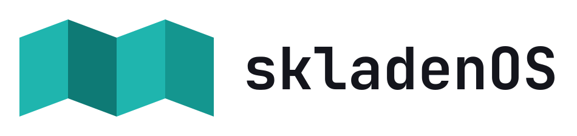

<p align="center">
  <picture>
    <source media="(prefers-color-scheme: dark)" srcset="packages/skladenos-artwork/files/usr/share/skladenos/logo/logo-horizontal-dark.svg">
    
  </picture>
</p>

# skladenOS

[](https://github.com/mitya-labs/skladenos/actions/workflows/ci.yml)

*English summary:* skladenOS is a Linux handheld OS for the **Xiaomi Poco F1** (SDM845): Mobian (Debian forky) + the SXMO (sway) desktop, the Mobian 7.2 kernel with our PMI8998 Type-C/USB-PD patches, and a set of deb packages (settings, a first-boot wizard in 12 languages, fonts, emulators). Images are built with Docker from this repository and flashed with `fastboot`. Packages are available from an apt repository (release `garmon`), see the apt section below. Code is GPL-3.0; the logo and branded artwork are all-rights-reserved. The rest of this README is in Russian.

Linux-палмтоп на базе **Xiaomi Poco F1** (`xiaomi-beryllium`, SDM845): [Mobian](https://mobian.org) (Debian forky/testing) с оконным менеджером [SXMO](https://sxmo.org) (sway), ядро Mobian 7.2.11 с нашими патчами Type-C/PD для PMI8998 и набор deb-пакетов с настройками. Автор: Dmitrii Trifonov (Mitya Labs).

Зачем: телефон как карманный компьютер с физической клавиатурой, USB-хабом и питанием по Type-C, а не как смартфон. Корпус, клавиатура и хаб палмтопа ведутся отдельно; здесь — ОС, ядро и инструменты сборки.

Проект рабочий, но не релизный: образ из пакетов собирается и прошивается, мастер первой загрузки (язык на 12 языках, Bluetooth-клавиатура, Wi‑Fi, имя и пароль) пройден на железе. Короткий статус — [`SUMMARY.md`](SUMMARY.md). Ссылки «STATE п.N» в документах — номера пунктов внутреннего журнала работ, он в репозиторий не входит.

## Устройство

| | |
|---|---|
| Модель | Xiaomi Poco F1, M1805E10A (Global) |
| SoC / PMIC | Qualcomm SDM845 / PM8998 + PMI8998 |
| Панель | **EBBG** (FocalTech FT8719; драйвер и тач — только в форке/ядре Mobian). Бывает ещё Tianma (NT36672A, есть в mainline). Образ собирается под оба: `VARIANT=ebbg\|tianma` |
| Загрузчик | разблокирован (нужно для прошивки) |
| Прошивки Android | MIUI V12.0.3.0.QEJMIXM, обновлены только firmware-разделы ([LineageOS wiki](https://wiki.lineageos.org/devices/beryllium/fw_update/)) |

## Статус

Работает на телефоне (образ из этого репозитория на Mobian weekly 2026-09-27, SXMO по умолчанию, ядро 7.2.11; подробности — `SUMMARY.md`):

| | |
|---|---|
| Работает | загрузка, экран и тач (вырез учтён в SXMO), Wi-Fi 2,4 ГГц, Bluetooth, зарядка, звук (стерео), микрофон, USB-сеть по кабелю (`10.66.0.1`), модем поднимается, датчики (`slpi`: акселерометр, гироскоп, магнитометр, свет, приближение), камера через libcamera (на ядре 7.2), USB-OTG: хаб, клавиатура, флешки, Ethernet — Type-C с автоопределением роли, питание хаба от VBUS, USB PD (DR_Swap) |
| Не работает / не проверено | fbcon-текст при загрузке обрезается вырезом (ядро не умеет отступы для DSI); автофокус камеры (`bu64748`, ошибка `-6`), картинка повёрнута на 90°; **SIM не проверялась** (звонки, SMS, data — нет); Wi-Fi 5 ГГц на DFS-каналах (deauth); расход батареи и suspend в долгой работе не измерены; быстрая зарядка 9–15 В не включена (блок 45 Вт даёт 5 В, ≤1,5 А) |
| В разработке | CI на GitHub Actions; полный чек-лист образа на железе (ночной расход батареи); вариант панели `tianma` не проверен |

## Что внутри

- **Ядро**: исходники Mobian `qcom-linux`, тег `mobian/sdm845-7.2.11-1` ([`build/kernel/UPSTREAM`](build/kernel/UPSTREAM)) + патчи в [`patches/pmi8998-typec/`](patches/pmi8998-typec/): драйвер Type-C PMI8998 (серия taygoth v1, `0001`–`0007`), таблица токов VBUS PMI8998 (MacInnes, `0008`), TCPM-бэкенд PMI8998 с USB PD и DT (`pd/0009`–`0010`, наши). Сборка в Docker.
- **Пакеты** ([`packages/`](packages/README.md)): `skladenos-config` (слой A — системные настройки; слой B — `skladenos-apply`, пользовательский конфиг SXMO), `skladenos-wallpapers`, `skladenos-artwork`, `skladenos-fonts` (DejaVu Sans Mono Nerd Font для значков), `skladenos-firstboot` (мастер первой загрузки: Bluetooth-клавиатура, Wi-Fi, смена имени и пароля; TUI на Textual в `foot`).
- **Образ** ([`build/image/`](build/image/README.md)): официальный rootfs Mobian + пакеты + наше ядро → `boot.img` (с `rw`) и `userdata.simg.zst` для fastboot.
- **Снимки и восстановление**: `scripts/mobian-snapshot` снимает корень и `boot` живого телефона, `scripts/snapshot-flash` прошивает; порядок с нуля — [`RESTORE.md`](RESTORE.md).
- **Скрипты** `scripts/`: прошивка, постнастройка живого телефона (`mobian-postinstall`, `sxmo-setup`, `pmi8998-*`, `slpi-install`, `tas2559-install`, `powerplan-install`), замер здоровья, `phone-ssh`, `phone-usb`, `phone-nosleep`.

## Быстрый старт

Нужны Mac/Linux, Docker, `fastboot`, разблокированный загрузчик. Rootfs Mobian (`mobian-sdm845-phosh-20260927.rootfs.img`) скачивается отдельно и кладётся в `images/mobian/` (`images/` — вне git).

```sh
packages/build.sh skladenos-config          # и так для каждого пакета -> out/packages/*.deb
build/kernel/build.sh check                 # патчи ложатся на тег (~3 мин)
build/kernel/build.sh deb                   # ядро -> out/kernel/ (~17 мин)
build/image/build.sh check                  # предпосылки
build/image/build.sh build                  # образ -> out/image/<метка>/ (~5 мин по факту 22.10; по оценке сборки до 25-40 мин)
```

Прошивка (**стирает userdata, то есть весь телефон**; телефон в fastboot: Power + Vol−, кабель напрямую в хост, не в виртуалку):

```sh
scripts/snapshot-flash out/image/<метка>
```

Вход после прошивки:

| | Пользователь | Пароль |
|---|---|---|
| Образ из `build/image` | `skladen` | `1234` (мастер первой загрузки заставляет сменить) |

SSH: по Wi-Fi или по USB-кабелю `ssh <пользователь>@10.66.0.1`. В новом образе пароль по SSH до смены пароля мастером разрешён только из локальных сетей (ключи работают всегда). Мастер первой загрузки предлагает сменить имя и обязательно требует сменить пароль; имя применяется после перезагрузки.

## Пакеты из apt-репозитория (garmon)

Пакеты проекта (эмуляторы HP Jornada 720 и Psion 5mx, метапакеты `skladenos-tools`, `-dev`, `-containers`, обновления `skladenos-config` и другие) лежат в подписанном apt-репозитории, релиз **garmon**, архитектура arm64. В образе источник уже включён (пакет `skladenos-archive-keyring`). На другой системе (Mobian/Debian forky на Poco F1):

```sh
curl -fsS https://mitya-labs.github.io/apt/skladenos-archive-keyring.gpg | sudo tee /usr/share/keyrings/skladenos-archive-keyring.gpg >/dev/null
sudo tee /etc/apt/sources.list.d/skladenos.sources >/dev/null <<'EOF'
Types: deb
URIs: https://mitya-labs.github.io/apt
Suites: garmon
Components: main non-free
Signed-By: /usr/share/keyrings/skladenos-archive-keyring.gpg
EOF
sudo apt update
```

Отпечаток ключа подписи: `B27E 8856 988A 9019 BB9A 23F2 BBBD 1474 A352 F720`. Компонент `non-free` — наша графика под закрытой лицензией. Сборка и публикация репозитория: [`repo/`](repo/) (`repo/build.sh`, `repo/publish.sh`). Эмуляторы собираются в Docker скриптами [`packages/emulators/`](packages/emulators/), ROM-ов в пакетах нет.

## Структура репозитория

| Путь | Что |
|---|---|
| `packages/` | deb-пакеты `skladenos-*`, `build.sh`, `test-apply.sh` |
| `build/kernel/` | сборка ядра 7.2.11 (Docker, `UPSTREAM`) |
| `build/image/` | сборка прошиваемого образа |
| `build/sxmotest/` | Dockerfile для теста слоя B на настоящем sxmo-utils |
| `patches/pmi8998-typec/` | патчи ядра: Type-C, VBUS, TCPM/PD для PMI8998 |
| `scripts/` | прошивка, снимки, постнастройка, диагностика |
| `assets/` | графика и `NOTICE.md` о её лицензиях |
| `extras/` | необязательное, не в образе: эмуляторы (HP Jornada 720, Psion 5mx, PumpkinOS), SunVox |
| `SUMMARY.md`, `RESTORE.md`, `SXMO.md`, `PLAN.md` | статус, восстановление с нуля, шпаргалка SXMO, план (USB-host, Type-C; снятый план эпохи postmarketOS — `PLAN-archive-pmos.md`) |
| `repo/` | apt-репозиторий: сборка (`reprepro` в Docker), подпись, публикация |
| `AGENTS.md` | правила для ИИ-агентов, работающих с репозиторием |
| `images/`, `out/`, `logs/` | образы, результаты сборок, логи — вне git |

## Подводные камни

1. В `cmdline` раздела `boot` обязателен **`rw`** (`scripts/make-boot-rw`); без него бутлуп (`droid-juicer` не может сохранить `status.json`). После любой пересборки initramfs проверять.
2. Не использовать `flash_all*.sh` из MIUI (стирает/блокирует загрузчик); прошивки — только `scripts/miui-firmware-flash`.
3. Не пробрасывать телефон в виртуалку при `fastboot flash` (обрыв `usb_read failed e00002eb`).
4. ABL Xiaomi портит FILL-чанки sparse-образов (~1,5% блоков, детерминированно); не использовать «сырые» sparse-образы из старых заметок, прошивать готовое через `scripts/snapshot-flash` (STATE, раздел про образы и п.71).
5. `rmtfs-dir.service` замаскирован (иначе два `rmtfs`, модем падает, нет Wi-Fi). SLPI на ядре 6.12 не запускать (краш-цикл); на 7.2 работает через `slpi-install`.
6. Смена версии пакета ядра ломает установленные патчи PMI8998 на живом телефоне — нужна пересборка (STATE п.93); в образе PD приходит из пакета ядра.

## Лицензии

| Что | Лицензия |
|---|---|
| Пакеты `skladenos-config`, `skladenos-firstboot` (код, скрипты в них) | GPL-3+ (по `debian/copyright`) |
| Остальной код репозитория (`scripts/`, `build/`, `extras/`, `tools/`, `packages/`) | GPL-3.0 (файл `LICENSE` в корне); графика и обои — по строкам ниже |
| Свободные обои «Skladen v2.1» (`skladenos-wallpapers`, без логотипа) | CC BY-SA 4.0: можно копировать и менять с указанием автора и под той же лицензией |
| Логотип skladenOS (вверху этого README), логотип Mitya Labs (пёс), фирменные обои, названия «Skladen» и «skladenOS» | **не свободные**, все права защищены, © 2026 Dmitrii Trifonov; `skladenos-artwork`, `Section: non-free`. Не входят в лицензию кода и свободных обоев; показ в README не даёт права использовать логотип в своих проектах, копировать и изменять его без письменного разрешения автора |
| Шрифт надписей на обоях и в логотипе | JetBrains Mono, SIL OFL 1.1 |
| `skladenos-fonts` | DejaVu Sans Mono (Bitstream Vera) + Nerd Fonts 3.4.0 (MIT) + наборы значков под своими лицензиями (MIT, Apache-2.0, CC BY 4.0, OFL 1.1, Unlicense); тексты и держатели прав — в `packages/skladenos-fonts/debian/copyright`. У старых иконок Devicons от vorillaz держатель прав не подтверждён; логотипы брендов остаются торговыми марками их владельцев (STATE п.141) |
| Патчи ядра | GPL-2.0 как часть Linux; авторские права у авторов серий (см. заголовки патчей) |

Лицензия каждого файла описана по стандарту [REUSE](https://reuse.software): правила в [`REUSE.toml`](REUSE.toml), тексты лицензий в [`LICENSES/`](LICENSES/), проверка `reuse lint` (проходит: 321 из 321 файла). Правила по названиям и логотипу — [`TRADEMARK.md`](TRADEMARK.md).

Подробно: [`assets/NOTICE.md`](assets/NOTICE.md), `packages/*/debian/copyright`.

## Благодарности и ссылки

- [Mobian](https://mobian.org) (ядро `qcom-linux`, rootfs), [SXMO](https://sxmo.org), [sdm845-mainline](https://gitlab.com/sdm845-mainline/linux), [postmarketOS](https://postmarketos.org) (исходная платформа проекта; значки взяты из их `ttf-dejavu-nerd`), [Nerd Fonts](https://github.com/ryanoasis/nerd-fonts).
- Патчи Type-C PMI8998: серия taygoth v1 (апстрим), таблица токов VBUS — MacInnes; ветка Кейси [b4/pmi8998-typec](https://git.codelinaro.org/casey_connolly/kernel/-/commits/b4/pmi8998-typec/); [патчи role-switch (Furman, май 2026)](https://ratatoskr.run/linux-usb/2026/05/16996111/t). TODO: уточнить полные имена и ссылки на авторов по заголовкам патчей.
- История с загрузкой (чёрный экран на SDM845, давно решено на Mobian/ядре 7.x): [drm/msm#46](https://gitlab.freedesktop.org/drm/msm/-/work_items/46), [pmOS: SDM845 black screen](https://postmarketos.org/edge/2023/12/08/sdm845-no-display/).
- Вики: [Xiaomi POCO F1](https://wiki.nura.eco/wiki/Xiaomi_POCO_F1_(xiaomi-beryllium)), [OnePlus 6](https://wiki.nura.eco/wiki/OnePlus_6_(oneplus-enchilada)) (закрыта от ботов; API открыт: `https://wiki.nura.eco/api.php?action=query&prop=revisions&rvprop=content&rvslots=main&format=json&titles=<Страница>`).
- Mainline DT: `arch/arm64/boot/dts/qcom/sdm845-xiaomi-beryllium-{common.dtsi,tianma.dts,ebbg.dts}`; драйвер панели Tianma — `panel-novatek-nt36672a.c`.
- Matrix: `#sdm845:postmarketos.org`, `#postmarketos-mainline`.
